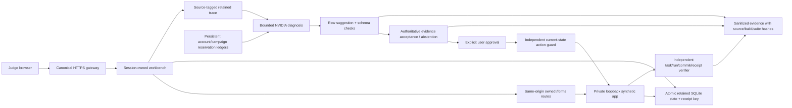

# ReceiptLab release-candidate architecture

Local mode remains a loopback-only development lab with ephemeral sessions. Prepared public mode requires an exact configured HTTPS origin and absolute retained-state directory; it still binds the backend to loopback for a separately approved TLS gateway. Caller-supplied Host/Origin and forwarded-header spoofing are rejected. Caddy strips proxy metadata and preserves the configured canonical Host; forms and their assets/API are routed beneath /forms, with session ownership checked before forwarding. Raw app/evaluator/signing key stay private. No public origin is currently deployed.

Public state uses Node built-in SQLite with synchronous commits, one atomic snapshot of sessions/records/receipt key and used approvals, and a separate SQLite OS-released exclusive instance lease. Completed receipts/sessions survive process restart and SIGKILL. In-flight operations are quarantined instead of replayed. Corrupt/read-only/failed storage poisons the runtime and fails closed; the system never seeds new verification state to hide failure. The model budget requires a real retained root and imported cumulative account history; it does not initialize a new59USD balance when a volume disappears. This is a single-active-instance design, not distributed/HA coordination.

Default startup never calls a model. An explicit owner-authorized live service pins source/runtime/suite/model/current prices, named scenarios, calls/output/reservation and existing-credit-only evidence. It opens/validates the runtime before capability preflight and admits diagnoses only after preflight succeeds. Shared account/campaign file reservations fsync before POST, retain unknown usage conservatively, disallow resume/retry/fallback and drain in-flight work before settlement. Gitless images require runtime-manifest match plus authorization-pinned runtime hash; operator commit claims alone are insufficient. Short campaign expiry/crash intentionally stops inference; no automatic renewal is configured.

Raw model output is preserved separately from accepted advice. Strict schema/citation checks are followed by conservative support tests: cited authoritative cause, current pending/commit/retry state and runtime private permissions. Unsupported/high-confidence/wrong-state advice is replaced by explicit ambiguous/stop abstention, with the raw confidence error visible only in warned audit details. Current verified completion supersedes historical failures. This is not a universal semantic truth oracle. Misclassification or unsupported prose can remain; independent explicit approval, private action restrictions and receipt verification are still essential.

A diagnosis never executes recovery or proves completion. The private guard only permits currently eligible synthetic retry, supplied consent renewal or supplied-number formatting. Approval binds diagnosis/run/current trace and is single-use. The verifier independently checks intended task/run, exact normalized values, one commit and HMAC receipt after action. Export contains verdicts, raw/accepted metadata, usage/cost estimates and hashes; it omits keys, signatures, raw contacts and reasoning. HMAC is privately checked; exported hashes are content-consistency records, not public-key authenticity certificates.

Test evidence includes real Chromium HTTPS/restart, separate-process crash/replay/storage negatives, actual local Caddy gateway/header stripping, mocked provider boundaries and source-pinned paid experiments. None establishes hosting entitlement, public DNS/ACME, uptime through December15, external expert validation or arbitrary-website efficacy. Owner license/eligibility and public hosting/merge/media/submission approvals remain separate.
