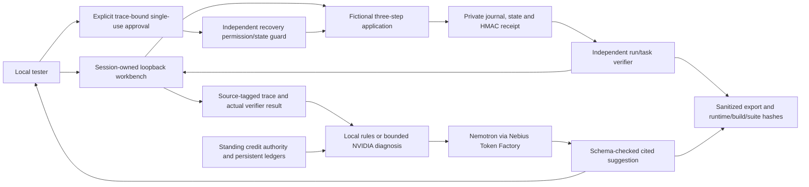

# ReceiptLab architecture and trust boundaries

The default manual workbench has no model policy. An explicitly started local service campaign admits a fixed model, source/suite, named scenarios and3POST/.02 estimated reservation. First request must pass strict preflight. Model diagnosis uses the exact output schema in prompt and response_format, fixed endpoint, no retries/redirect/fallback and positive consistent usage. Admission closes and pending work drains before ledger settlement. Failed provider/schema responses remain attempted-live evidence; unknown request/cost totals remain null, with the campaign ledger authoritative.

Diagnosis never executes recovery. The recovery guard supports only supplied-phone formatting, expired supplied consent or retry after a known transient synthetic error. It checks private current state, task values and unchanged trace; approval is single-use. The verifier rechecks resulting state, intended task/run, unique commit and receipt independently of suggestions. UI claims, completed diagnoses and confidence have no completion authority. Static diagnostic evaluation hides author verification labels from both policies; runtime application verification is real evidence and remains authoritative.

HttpOnly/SameSite=Strict capability sessions, exact host/origin checks, same-origin POSTs, body/rate/session/run/TTL limits, no third-party assets and textContent rendering bound the local demo. Provider credentials and reasoning remain server-side. Browser-agent contexts additionally restrict traffic/actions to their own fictional run. Public field semantics are equally available to policies. Exported hashes/checksums indicate content consistency; HMAC is verified privately, not a public-key certificate.

Restart clears sessions/state/signing keys. Fsynced campaign/account files are workspace-local coordination and conservative token estimates, not a distributed provider billing cap. Public release still needs HTTPS/Secure cookies, isolated routing for dynamic child forms, durable state/keys, shared multi-replica budgets, access/abuse controls and separately approved hosting. Never expose the raw app or current unrestricted development ports publicly.
